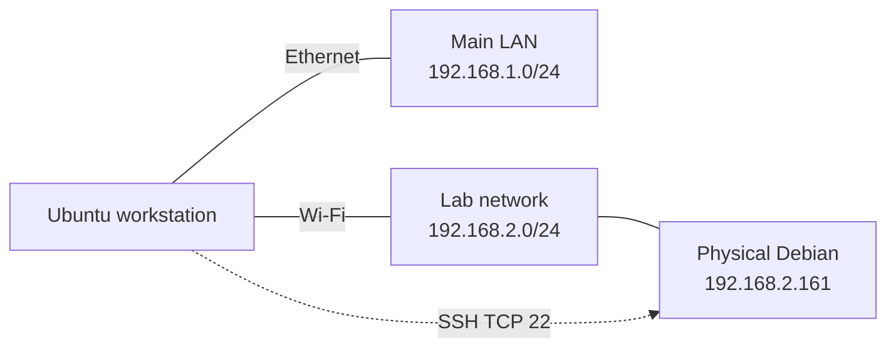
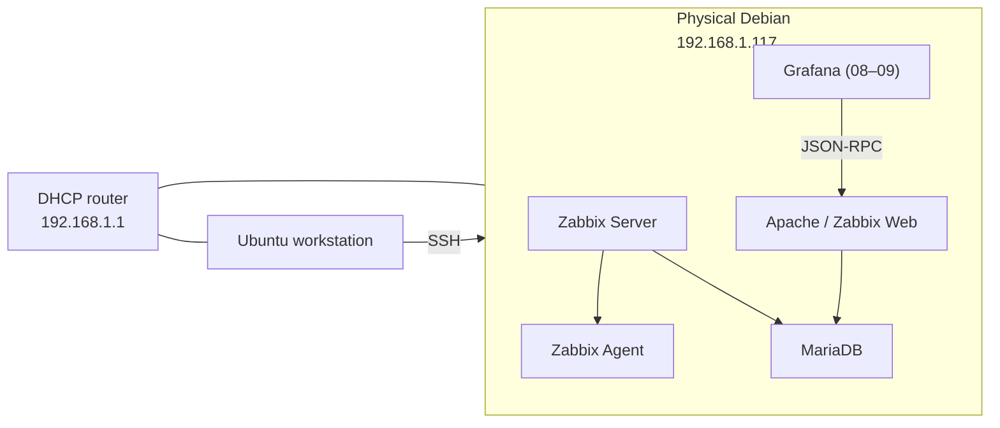
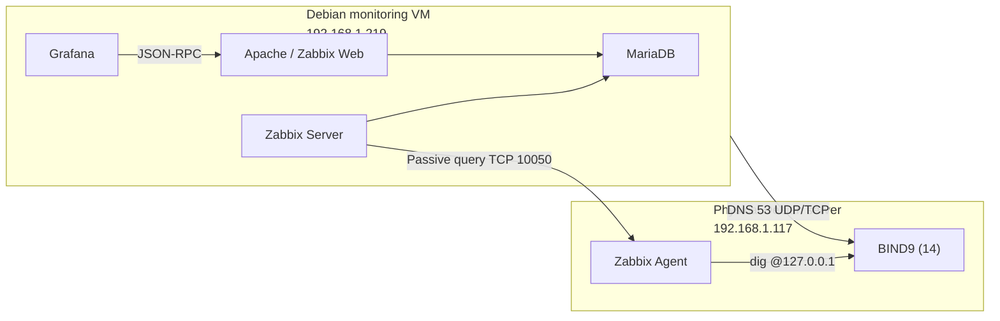

# Historical architecture

[Index](README.md) · [Português (Brasil)](../pt-BR/docs/arquitetura.md)

These diagrams summarize the configurations documented at different stages, not the equipment's present state. Query arrows indicate who initiates communication; they do not represent every traffic flow.

## Stage 1 — dedicated network (01–04)

The workstation had interfaces on separate subnets. The server received its address through DHCP. Zabbix, MariaDB and the Apache frontend were added in Lab 02; UFW in Lab 03; Nginx on TCP 8080 in Lab 04, with Stub Status restricted to loopback.

[Installation and SSH](labs/01-installation-configuration-ssh/README.md) · [Zabbix server](labs/02-monitoring-server-with-zabbix/README.md) · [UFW](labs/03-firewall-access-control/README.md) · [Nginx](labs/04-nginx-web-server/README.md)

## Stage 2 — main LAN and local monitoring (05–10)

Lab 07 documents the DHCP reservation after the temporary change to 192.168.1.116. Grafana was installed in Labs 08–09 and removed in Lab 10 for resource management. The diagram does not imply that every service was verified simultaneously in each lab.

[DHCP reservation](labs/07-dhcp-reservation-and-ip-address-persistence/README.md) · [Grafana integration](labs/08-grafana-zabbix-integration/README.md) · [Grafana removal](labs/10-grafana-removal-and-resource-optimization/README.md)

## Stage 3 — separate monitoring and infrastructure (11–14)

The VirtualBox VM uses a bridged adapter, 2 vCPUs, 4 GB of RAM and a 32 GB VDI disk. Its static IP was configured with dhcpcd. Lab 12 records removal of the physical server's Zabbix stack while retaining its agent; Lab 13 records Grafana on the VM and an ongoing dashboard; Lab 14 adds physical BIND9 and a functional DNS resolution check.

[Zabbix migration](labs/11-migrating-the-zabbix-monitoring-server-to-a-virtual-machine/README.md) · [Physical server cleanup](labs/12-zabbix-removal-and-server-cleanup/README.md) · [Grafana on VM](labs/13-grafana-custom-monitoring-dashboard/README.md) · [BIND9](labs/14-bind9-dns-server/README.md)

For the sequence of changes, see the [infrastructure timeline](infrastructure-timeline.md).
