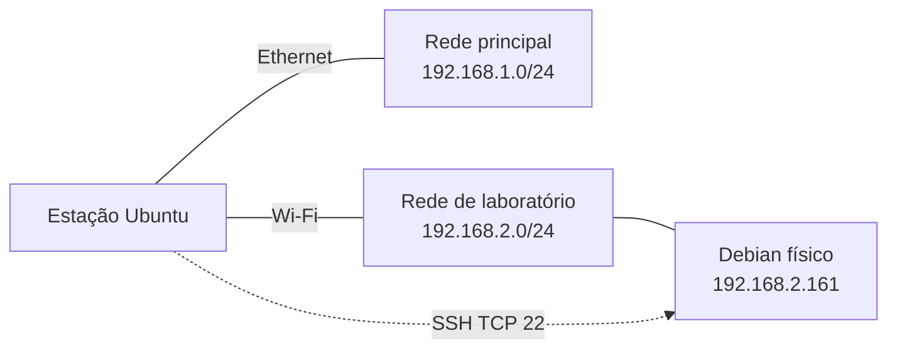
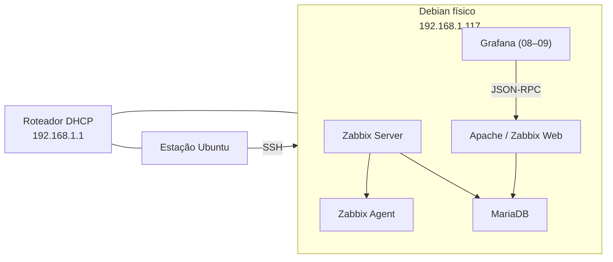
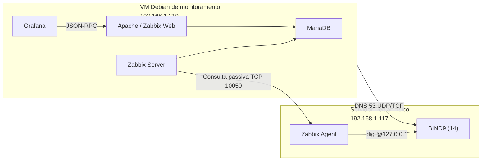

# Arquitetura histórica

[Índice](README.md) · [English](../../docs/architecture.md)

Estes diagramas sintetizam as configurações documentadas nas diferentes etapas, e não o estado atual do equipamento. As setas de consulta indicam quem inicia a comunicação; não representam todos os fluxos de tráfego.

## Etapa 1 — rede dedicada (01–04)

A estação tinha interfaces em sub-redes distintas. O servidor recebeu seu endereço por DHCP. O Zabbix, MariaDB e frontend Apache foram adicionados no Lab 02; UFW no Lab 03; Nginx em TCP 8080 no Lab 04, com Stub Status restrito ao loopback.

[Instalação e SSH](laboratorios/01-instalacao-configuracao-ssh/README.md) · [Servidor Zabbix](laboratorios/02-servidor-de-monitoramento-zabbix/README.md) · [UFW](laboratorios/03-firewall-e-controle-de-acesso/README.md) · [Nginx](laboratorios/04-servidor-web-nginx/README.md)

## Etapa 2 — LAN principal e monitoramento local (05–10)

O Lab 07 documenta a reserva DHCP após a mudança temporária para 192.168.1.116. O Grafana foi instalado nos Labs 08–09 e removido no Lab 10 por decisão de gerenciamento de recursos. O diagrama não implica que todos os serviços foram verificados simultaneamente em cada laboratório.

[Reserva DHCP](laboratorios/07-reserva-dhcp-e-persistencia-de-ip/README.md) · [Integração Grafana](laboratorios/08-integracao-grafana-zabbix/README.md) · [Remoção do Grafana](laboratorios/10-remocao-do-grafana-e-otimizacao-de-recursos/README.md)

## Etapa 3 — monitoramento separado da infraestrutura (11–14)

A VM VirtualBox usa adaptador em bridge, 2 vCPUs, 4 GB de RAM e disco VDI de 32 GB. O IP estático foi configurado com dhcpcd. O Lab 12 registra a remoção da pilha Zabbix do servidor físico, mantendo seu agente; o Lab 13 registra Grafana na VM e dashboard em andamento; o Lab 14 acrescenta BIND9 físico e a verificação funcional de resolução DNS.

[Migração do Zabbix](laboratorios/11-migracao-do-servidor-zabbix-para-maquina-virtual/README.md) · [Limpeza do servidor físico](laboratorios/12-remocao-do-zabbix-e-limpeza-do-servidor/README.md) · [Grafana na VM](laboratorios/13-dashboard-personalizado-grafana/README.md) · [BIND9](laboratorios/14-servidor-dns-bind9/README.md)

Para a sequência das mudanças, consulte a [evolução da infraestrutura](evolucao-da-infraestrutura.md).
