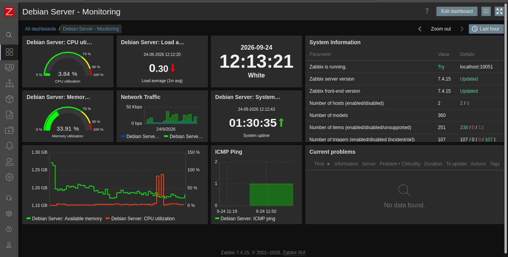

# Lab 05 - Dashboard personalizado do Zabbix

[English](../../../../docs/labs/05-zabbix-custom-dashboard/README.md) · [Índice dos laboratórios](../../README.md) · [Laboratório anterior](../04-servidor-web-nginx/README.md) · [Próximo laboratório](../06-pagina-estatica-apache/README.md)

## Descrição

Este laboratório documenta a criação e configuração de um dashboard personalizado do Zabbix para o servidor Debian físico.

Diferentemente dos laboratórios anteriores, que utilizavam a antiga sub-rede, este laboratório utiliza a rede local principal:

```text
192.168.1.0/24
```

O servidor Debian monitorado utilizava nesta etapa:

```text
192.168.1.117
```

A instalação do Zabbix e a configuração do servidor foram documentadas nos laboratórios anteriores. Este laboratório tem foco específico em **projeto de dashboard, visualização, métricas monitoradas, widgets e interpretação das informações exibidas pelo Zabbix**.

O objetivo é criar um dashboard centralizado que forneça uma visão rápida da condição do servidor e de seu comportamento histórico.

---

## 1. Visão geral do dashboard

O dashboard personalizado foi projetado especificamente para o host `Debian Server`.

O dashboard combina diferentes widgets do Zabbix para que as informações mais relevantes possam ser observadas sem navegar por páginas individuais de monitoramento.

O dashboard final contém:

* Utilização da CPU
* Utilização de memória
* Tempo de atividade do sistema
* Load average
* Gráfico histórico da CPU
* Gráfico histórico de memória
* Problemas ativos



O dashboard está organizado para fornecer tanto **informações do estado atual** quanto **informações históricas**.

Widgets do tipo gauge fornecem uma representação visual imediata da utilização de recursos, enquanto os gráficos históricos permitem observar mudanças ao longo do tempo. O widget Problems oferece visibilidade dos eventos detectados pelo Zabbix.

---

## 2. Disposição do dashboard

O dashboard foi organizado em sete widgets principais:

| Widget | Finalidade |
| --- | --- |
| CPU Utilization | Exibe o uso atual da CPU |
| Memory Utilization | Exibe o uso atual de memória |
| System Uptime | Exibe há quanto tempo o servidor está em execução |
| Load Average | Exibe o load average atual do Linux |
| CPU Graph | Exibe a atividade da CPU ao longo do tempo |
| Memory Graph | Exibe o uso de memória ao longo do tempo |
| Problems | Exibe problemas detectados pelo Zabbix |

A intenção foi manter o dashboard simples o suficiente para uma leitura rápida, fornecendo ainda informações suficientes para investigar o estado do servidor.

---

## 3. Utilização da CPU

O widget de utilização da CPU exibe a porcentagem atual dos recursos de CPU utilizados pelo servidor Debian.

O servidor possui:

```text
4 CPU cores
```

No momento em que os dados do dashboard foram coletados, o servidor informou:

```text
CPU utilization: 6.6633%
CPU idle: 93.3367%
```

Outras métricas de CPU disponíveis pelo Zabbix incluíam:

```text
CPU user:    4.6056%
CPU system:  1.6895%
CPU iowait:  0.2059%
CPU softirq: 0.05043%
```

O gauge foi configurado com limites em:

```text
70%
90%
```

Esses limites fornecem pontos de referência visuais para o aumento da utilização da CPU.

Um teste de estresse da CPU também foi realizado durante o laboratório utilizando:

```bash
stress --cpu 4 --timeout 60
```

A finalidade era gerar atividade de CPU e observar como o dashboard responde ao aumento da carga de trabalho.

---

## 4. Utilização de memória

O widget de utilização de memória exibe a porcentagem de RAM utilizada pelo servidor naquele momento.

O servidor monitorado possui:

```text
Total memory: 1.79 GB
```

No momento da captura dos dados de monitoramento:

```text
Memory utilization: 33.7464%
Available memory: 1.19 GB
Available memory: 66.2536%
```

O servidor também possuía:

```text
Total swap: 1.51 GB
Free swap: 1.51 GB
Free swap: 100%
```

O gauge de memória foi configurado para fornecer uma indicação visual rápida do consumo de memória.

---

## 5. Tempo de atividade do sistema

O dashboard inclui um widget Item value dedicado ao tempo de atividade do sistema.

O horário de inicialização do servidor registrado pelo Zabbix foi:

```text
24-09-2026 10:42:09
```

O tempo de atividade no momento da captura dos dados era aproximadamente:

```text
01:41:05
```

Exibir o tempo de atividade diretamente no dashboard permite determinar rapidamente se o servidor foi reiniciado recentemente.

---

## 6. Load average

O widget Load Average exibe o load average do Linux para três períodos distintos.

Os valores capturados foram:

| Período | Load average |
| --- | ---: |
| 1 minuto | 0.1797 |
| 5 minutos | 0.2549 |
| 15 minutos | 0.3608 |

O load average complementa a utilização da CPU fornecendo outra visão da carga de trabalho do sistema.

Os três valores permitem comparar a carga atual com a carga recente em intervalos mais longos.

---

## 7. Gráfico histórico da CPU

Um gráfico histórico da CPU foi adicionado ao dashboard para complementar o gauge instantâneo de CPU.

Enquanto o gauge mostra o estado atual, o gráfico permite observar como a atividade da CPU muda ao longo do tempo.

O gráfico pode ser utilizado para identificar:

* Picos temporários de CPU
* Uso sustentado de CPU
* Períodos de baixa atividade
* Efeitos de cargas de trabalho e testes
* Mudanças no comportamento da CPU ao longo do tempo

Isso é particularmente útil ao investigar um problema que já não ocorre no momento da análise.

---

## 8. Gráfico histórico de memória

O gráfico de memória fornece informações históricas sobre a utilização de RAM.

O gráfico complementa o gauge de memória porque este representa apenas o estado atual, enquanto o gráfico pode revelar mudanças ao longo do tempo.

Ele pode ser utilizado para identificar:

* Aumento do consumo de memória
* Mudanças repentinas no uso de memória
* Períodos de alta utilização
* Padrões de uso de longo prazo

Para um servidor com apenas 1.79 GB de RAM, observar o comportamento da memória ao longo do tempo é particularmente útil.

---

## 9. Widget Problems

O widget Problems foi configurado para exibir problemas associados ao:

```text
Debian Server
```

Durante o laboratório, o Zabbix detectou um problema real relacionado a uma alteração na quantidade de pacotes instalados:

```text
Linux: Number of installed packages has been changed
```

O evento capturado apresentava:

```text
Event ID: 88
Trigger ID: 32564
Duration at capture: 9m 35s
```

O servidor informava naquele momento:

```text
Installed packages: 513
```

Isso forneceu uma demonstração prática de como uma mudança detectada por um item pode resultar em uma trigger do Zabbix e, posteriormente, aparecer como problema no dashboard.

O fluxo de monitoramento pode ser representado como:

```text
Monitored Item
      ↓
Trigger
      ↓
Event
      ↓
Problem
      ↓
Dashboard
```

Essa é uma das funções mais importantes do widget Problems, pois permite visualizar eventos operacionais junto às métricas de desempenho do servidor.

---

## 10. Informações de rede

Embora o dashboard tenha foco principalmente nos recursos do sistema, o host monitorado também fornece informações de rede pelo Zabbix.

O servidor Debian utiliza:

```text
Interface: wlan0
IP: 192.168.1.117
```

As métricas de rede capturadas incluíam:

| Métrica | Valor |
| --- | ---: |
| Tráfego de entrada | 14.52 Kbps |
| Tráfego de saída | 22.5 Kbps |
| Erros de entrada | 0 |
| Erros de saída | 0 |
| Pacotes de entrada descartados | 5 |
| Pacotes de saída descartados | 0 |
| Estado operacional | Up |

As informações de rede fornecem contexto adicional ao analisar o comportamento do servidor.

---

## 11. Informações de armazenamento

O host monitorado pelo dashboard também fornece métricas de armazenamento.

O dispositivo de armazenamento principal é:

```text
mmcblk2
```

No momento da captura de monitoramento:

```text
Disk utilization: 4.9531%
Write rate: 5.4998 writes/s
```

O sistema de arquivos raiz é:

```text
/
```

com:

```text
Filesystem: ext4
Total: 26.07 GB
Used: 1.93 GB
Available: 22.79 GB
Usage: 7.7952%
Free inodes: 97.43%
```

Essas métricas estão disponíveis nos dados de monitoramento do host, embora o armazenamento não seja um dos widgets principais deste dashboard.

---

## 12. Captura das métricas do servidor

Os valores seguintes representam o servidor no momento em que o dashboard foi documentado:

| Métrica | Valor |
| --- | ---: |
| Utilização da CPU | 6.6633% |
| CPU ociosa | 93.3367% |
| Utilização de memória | 33.7464% |
| Memória disponível | 1.19 GB |
| Memória total | 1.79 GB |
| Swap total | 1.51 GB |
| Utilização do sistema de arquivos raiz | 7.7952% |
| Capacidade total do sistema de arquivos raiz | 26.07 GB |
| Load average 1m | 0.1797 |
| Load average 5m | 0.2549 |
| Load average 15m | 0.3608 |
| Núcleos da CPU | 4 |
| Pacotes instalados | 513 |
| Processos | 227 |
| Usuários conectados | 3 |
| Zabbix Agent | 7.4.15 |
| Disponibilidade do agente | Available |

Esses valores representam uma captura do sistema monitorado e devem mudar conforme o servidor opera.

---

## 13. Convenção de cores do dashboard

O dashboard utiliza cores para facilitar a distinção entre diferentes tipos de informação.

A convenção visual utilizada durante o laboratório foi:

| Informação | Cor |
| --- | --- |
| Download | Azul |
| Upload | Verde |
| Memória disponível | Verde |
| Utilização da CPU | Laranja |
| Problemas | Vermelho |

As cores são utilizadas como indicadores visuais. Os valores efetivos das métricas continuam sendo a fonte principal de informação.

---

## 14. Objetivos do projeto do dashboard

O dashboard foi projetado em torno de três objetivos principais:

### Visibilidade

As métricas mais importantes do servidor devem estar visíveis imediatamente após abrir o dashboard.

### Simplicidade

O dashboard deve evitar informações desnecessárias e focar em métricas úteis para compreender rapidamente a condição do servidor.

### Diagnóstico

O dashboard deve fornecer informações suficientes para identificar comportamentos anormais e determinar quando uma investigação adicional é necessária.

A combinação de gauges, Item values, gráficos e o widget Problems fornece diferentes níveis de informação sem exigir múltiplas páginas de monitoramento.

---

## 15. Monitoramento atual versus histórico

Um dos conceitos principais demonstrados por este dashboard é a diferença entre monitoramento atual e histórico.

### Valores atuais

Os gauges e widgets Item value fornecem uma visão imediata do servidor.

Exemplos:

```text
CPU utilization
Memory utilization
Load average
Uptime
```

### Valores históricos

Os gráficos de CPU e memória fornecem informações sobre o que aconteceu ao longo do tempo.

Essa distinção é importante no monitoramento de servidores porque um problema pode já ter desaparecido quando o administrador o investiga.

Por exemplo, um pico de CPU pode não estar mais visível no gauge de CPU, mas ainda pode ser observado no gráfico histórico.

---

## 16. Itens, triggers e problemas do Zabbix

O dashboard também ajudou a demonstrar a relação entre os principais componentes de monitoramento do Zabbix.

### Itens

Os itens coletam informações individuais do host monitorado.

Exemplos incluem:

```text
CPU utilization
Memory utilization
Network traffic
Filesystem usage
Load average
Number of installed packages
```

### Triggers

As triggers avaliam valores coletados e condições.

Uma trigger pode determinar quando uma condição monitorada deve gerar um evento.

### Problemas

Quando uma condição de trigger é atendida, o Zabbix pode gerar um problema que se torna visível pelo widget Problems.

Isso torna o dashboard mais do que uma coleção de gráficos. Ele também se torna um local onde condições detectadas podem ser investigadas.

---

## 17. Resultado do dashboard

O dashboard final fornece uma visão centralizada dos dados de monitoramento do servidor Debian.

Ele combina:

```text
                    Debian Server
                         │
          ┌──────────────┼──────────────┐
          │              │              │
        CPU           Memory          System
          │              │              │
       Gauge          Gauge       Uptime / Load
          │              │              │
          └──────────────┼──────────────┘
                         │
                   Historical Data
                         │
                  CPU / Memory Graphs
                         │
                         ▼
                    Problems
                         │
                         ▼
                 Custom Dashboard
```

O resultado é um dashboard que pode ser utilizado como interface central de monitoramento do servidor Debian físico.

---

## 18. O que aprendi

Este laboratório teve foco no uso prático de dashboards do Zabbix, em vez da instalação da pilha de monitoramento.

Os conceitos principais praticados foram:

* Criar um dashboard personalizado no Zabbix
* Selecionar widgets adequados para o dashboard
* Configurar widgets Item value
* Configurar widgets gauge
* Configurar gráficos históricos
* Filtrar o widget Problems por host
* Compreender a diferença entre métricas atuais e históricas
* Interpretar a utilização da CPU
* Interpretar a utilização de memória
* Interpretar o load average do Linux
* Observar o tempo de atividade do servidor
* Compreender itens do Zabbix
* Compreender triggers do Zabbix
* Compreender problemas do Zabbix
* Utilizar convenções visuais no dashboard
* Gerar atividade de CPU e observar a resposta do monitoramento
* Utilizar um dashboard como interface centralizada de monitoramento

---

## 19. Estado do projeto

**Concluído**

O dashboard personalizado do Zabbix foi criado com sucesso para o host `Debian Server`.

O dashboard fornece uma visão centralizada da utilização de CPU, utilização de memória, tempo de atividade, load average, dados históricos de CPU e memória e problemas detectados.

Nesta etapa, o servidor monitorado utilizava a rede local principal:

```text
192.168.1.0/24
```

com o servidor Debian acessível em:

```text
192.168.1.117
```

Este laboratório representa, portanto, a configuração de monitoramento daquela etapa, substituindo a antiga sub-rede utilizada nos laboratórios anteriores.

[Galeria de capturas de tela](galeria.md)

[Índice dos laboratórios](../../README.md) · [Visão geral do repositório](../../../README.md)
