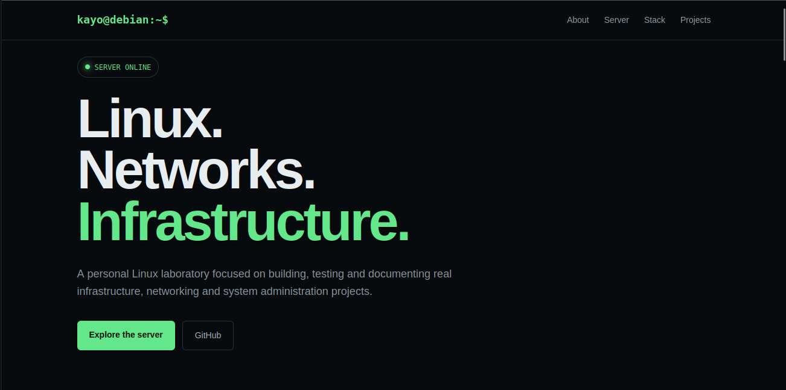
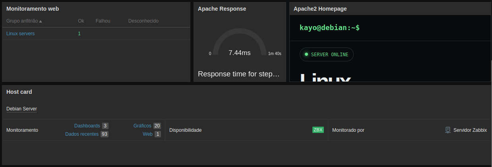

# Lab 06 - Página web estática com Apache

[English](../../../../docs/labs/06-apache-static-web-page/README.md) · [Índice dos laboratórios](../../README.md) · [Laboratório anterior](../05-dashboard-personalizado-zabbix/README.md) · [Próximo laboratório](../07-reserva-dhcp-e-persistencia-de-ip/README.md)

## Visão geral

Este laboratório tem foco na implantação e personalização de uma página web estática utilizando o Apache HTTP Server no servidor Debian.

Assim como no Lab 05, este servidor está conectado à rede local principal, diferentemente dos laboratórios 01–04:

```text
Network: 192.168.1.0/24
Server: 192.168.1.117
Gateway: 192.168.1.1
Interface: wlan0
```

O servidor Apache fornece a página web por HTTP na porta `80`.

O objetivo deste laboratório não era apenas servir uma página padrão do Apache, mas criar um site estático personalizado e integrar sua disponibilidade e tempo de resposta ao ambiente de monitoramento Zabbix existente.

---

## Objetivos

* Servir um site estático utilizando Apache HTTP Server
* Substituir a página padrão do Apache
* Criar uma página HTML personalizada com CSS incorporado
* Verificar disponibilidade HTTP
* Testar o servidor web utilizando `curl`
* Monitorar a página Apache pelo Zabbix Web Monitoring
* Monitorar o tempo de resposta do Apache
* Adicionar a página web monitorada ao dashboard Zabbix
* Criar uma representação visual do serviço web do servidor

---

## Ambiente

| Componente | Configuração |
| --- | --- |
| Sistema operacional | Debian 13 |
| Kernel | Linux 6.12.107+deb13-amd64 |
| Servidor web | Apache 2.4.68 |
| Porta HTTP | 80 |
| IP do servidor | `192.168.1.117` |
| Interface de rede | `wlan0` |
| Monitoramento | Zabbix 7.4 |
| Monitoramento web | Zabbix Web Scenario |
| Página web | `http://192.168.1.117/` |

---

## Servidor web Apache

O serviço Apache foi verificado com:

```bash
systemctl status apache2
```

O serviço estava em execução:

```text
Active: active (running)
```

O Apache também foi testado diretamente utilizando `curl`:

```bash
curl -I http://192.168.1.117/
```

O servidor retornou o código de estado HTTP `200 OK`, confirmando que a página web estava sendo servida com sucesso.

---

## Página estática personalizada

A página padrão do Apache foi substituída por um site estático personalizado.

A página foi criada diretamente em:

```text
/var/www/html/index.html
```

O site utiliza um único arquivo HTML com CSS incorporado.

Não são necessários JavaScript, bibliotecas externas, fontes externas ou recursos de CDN.

Isso permite que a página funcione inteiramente dentro do ambiente local de laboratório.

A página apresenta o servidor como um pequeno portfólio de infraestrutura e inclui informações sobre Linux, redes, monitoramento, infraestrutura e projetos.

### Estrutura da página

A página contém:

* Barra de navegação em estilo terminal
* Seção de estado do servidor
* Introdução sobre Linux e redes
* Seção sobre
* Informações do Debian Server Lab
* Pilha de tecnologias
* Links de projetos
* Citação sobre infraestrutura
* Links do GitHub e LinkedIn
* Rodapé

A identidade visual principal utiliza uma interface escura inspirada em ambientes de terminal e infraestrutura.

---

## Código-fonte HTML

A página estática completa está representada abaixo:

```html
<!DOCTYPE html>
<html lang="en">
<head>
    <meta charset="UTF-8">
    <meta name="viewport" content="width=device-width, initial-scale=1.0">

    <title>Kayo Willian | Debian Server Lab</title>

    <style>
        * {
            margin: 0;
            padding: 0;
            box-sizing: border-box;
        }

        html {
            scroll-behavior: smooth;
        }

        body {
            font-family: Arial, Helvetica, sans-serif;
            background: #0a0a0a;
            color: #e5e5e5;
            line-height: 1.6;
        }

        a {
            color: inherit;
            text-decoration: none;
        }

        nav {
            position: fixed;
            top: 0;
            left: 0;
            width: 100%;
            padding: 18px 8%;
            background: rgba(10, 10, 10, 0.92);
            border-bottom: 1px solid #222;
            z-index: 1000;
        }

        .nav-container {
            display: flex;
            justify-content: space-between;
            align-items: center;
        }

        .terminal {
            font-family: monospace;
            color: #ffffff;
        }

        .terminal span {
            color: #777;
        }

        .nav-links {
            display: flex;
            gap: 25px;
            color: #999;
            font-size: 14px;
        }

        .nav-links a:hover {
            color: #fff;
        }

        section {
            padding: 100px 8%;
        }

        .hero {
            min-height: 100vh;
            display: flex;
            flex-direction: column;
            justify-content: center;
            max-width: 1100px;
            margin: auto;
        }

        .status {
            display: inline-block;
            width: fit-content;
            padding: 7px 14px;
            border: 1px solid #333;
            border-radius: 4px;
            font-family: monospace;
            font-size: 13px;
            color: #9f9;
            margin-bottom: 30px;
        }

        .hero h1 {
            font-size: clamp(45px, 8vw, 90px);
            line-height: 1;
            margin-bottom: 25px;
            letter-spacing: -4px;
        }

        .hero p {
            max-width: 700px;
            color: #999;
            font-size: 20px;
        }

        .section-title {
            font-size: 38px;
            margin-bottom: 15px;
        }

        .section-description {
            max-width: 700px;
            color: #888;
            margin-bottom: 45px;
        }

        .about-grid {
            display: grid;
            grid-template-columns: repeat(auto-fit, minmax(280px, 1fr));
            gap: 30px;
        }

        .card {
            background: #111;
            border: 1px solid #222;
            padding: 30px;
            border-radius: 8px;
        }

        .card h3 {
            margin-bottom: 15px;
        }

        .card p {
            color: #888;
        }

        .server-info {
            display: grid;
            grid-template-columns: repeat(auto-fit, minmax(220px, 1fr));
            gap: 15px;
        }

        .info {
            background: #111;
            border: 1px solid #222;
            padding: 22px;
            border-radius: 6px;
        }

        .info small {
            display: block;
            color: #666;
            margin-bottom: 5px;
            font-family: monospace;
        }

        .info strong {
            font-family: monospace;
            color: #ddd;
        }

        .stack {
            display: grid;
            grid-template-columns: repeat(auto-fit, minmax(180px, 1fr));
            gap: 15px;
        }

        .stack-item {
            padding: 20px;
            background: #111;
            border: 1px solid #222;
            border-radius: 6px;
            font-family: monospace;
        }

        .projects {
            display: grid;
            grid-template-columns: repeat(auto-fit, minmax(250px, 1fr));
            gap: 20px;
        }

        .project {
            padding: 25px;
            background: #111;
            border: 1px solid #222;
            border-radius: 6px;
            transition: 0.2s;
        }

        .project:hover {
            transform: translateY(-3px);
            border-color: #555;
        }

        .project h3 {
            margin-bottom: 10px;
        }

        .project p {
            color: #888;
            font-size: 14px;
            margin-bottom: 15px;
        }

        .project-link {
            font-family: monospace;
            color: #aaa;
            font-size: 13px;
        }

        .quote {
            border-left: 2px solid #555;
            padding-left: 20px;
            color: #aaa;
            font-family: monospace;
            font-size: 18px;
            margin-top: 50px;
        }

        .links {
            display: flex;
            gap: 20px;
            margin-top: 35px;
        }

        .links a {
            padding: 10px 18px;
            border: 1px solid #333;
            border-radius: 5px;
            color: #aaa;
            font-family: monospace;
        }

        .links a:hover {
            color: #fff;
            border-color: #777;
        }

        footer {
            padding: 30px 8%;
            border-top: 1px solid #222;
            color: #555;
            text-align: center;
            font-size: 13px;
            font-family: monospace;
        }

        @media (max-width: 700px) {
            .nav-links {
                display: none;
            }

            .hero h1 {
                letter-spacing: -2px;
            }

            section {
                padding: 80px 6%;
            }
        }
    </style>
</head>

<body>

    <nav>
        <div class="nav-container">
            <div class="terminal">
                kayo@debian:~$
            </div>

            <div class="nav-links">
                <a href="#about">About</a>
                <a href="#server">Server</a>
                <a href="#stack">Stack</a>
                <a href="#projects">Projects</a>
            </div>
        </div>
    </nav>

    <section class="hero">
        <div class="status">
            ● SERVER ONLINE
        </div>

        <h1>
            Linux.<br>
            Networks.<br>
            Infrastructure.
        </h1>

        <p>
            Hands-on laboratory focused on Linux administration,
            networking, infrastructure, monitoring and cybersecurity.
        </p>
    </section>

    <section id="about">
        <h2 class="section-title">About</h2>

        <p class="section-description">
            A personal infrastructure laboratory built to practice
            Linux administration, networking, web services and monitoring
            in a real environment.
        </p>

        <div class="about-grid">
            <div class="card">
                <h3>Kayo Willian</h3>
                <p>
                    Hands-on learning focused on Linux, networking,
                    infrastructure and cybersecurity.
                </p>
            </div>

            <div class="card">
                <h3>Laboratory</h3>
                <p>
                    Physical Debian server used to deploy services,
                    perform experiments and build practical projects.
                </p>
            </div>
        </div>
    </section>

    <section id="server">
        <h2 class="section-title">Debian Server Lab</h2>

        <p class="section-description">
            Current infrastructure running on the laboratory server.
        </p>

        <div class="server-info">
            <div class="info">
                <small>OS</small>
                <strong>Debian 13</strong>
            </div>

            <div class="info">
                <small>KERNEL</small>
                <strong>Linux 6.12</strong>
            </div>

            <div class="info">
                <small>WEB SERVER</small>
                <strong>Apache</strong>
            </div>

            <div class="info">
                <small>MONITORING</small>
                <strong>Zabbix</strong>
            </div>
        </div>
    </section>

    <section id="stack">
        <h2 class="section-title">Technology Stack</h2>

        <p class="section-description">
            Technologies and concepts currently used throughout the laboratory.
        </p>

        <div class="stack">
            <div class="stack-item">Linux</div>
            <div class="stack-item">Networking</div>
            <div class="stack-item">Web Services</div>
            <div class="stack-item">Monitoring</div>
            <div class="stack-item">Administration</div>
            <div class="stack-item">Automation</div>
        </div>
    </section>

    <section id="projects">
        <h2 class="section-title">Projects</h2>

        <p class="section-description">
            Practical projects and laboratory documentation.
        </p>

        <div class="projects">

            <a class="project"
               href="https://github.com/kayo-willian/packet-tracer-labs"
               target="_blank">
                <h3>Packet Tracer Labs</h3>
                <p>
                    Networking laboratories covering routing,
                    switching, VLANs, OSPF and network services.
                </p>
                <span class="project-link">
                    github.com/kayo-willian/packet-tracer-labs
                </span>
            </a>

            <a class="project"
               href="https://github.com/kayo-willian/linux-networking-labs"
               target="_blank">
                <h3>Linux Networking Labs</h3>
                <p>
                    Practical Linux and networking experiments
                    documented as hands-on laboratories.
                </p>
                <span class="project-link">
                    github.com/kayo-willian/linux-networking-labs
                </span>
            </a>

            <a class="project"
               href="https://github.com/kayo-willian/debian-server-labs"
               target="_blank">
                <h3>Debian Server Labs</h3>
                <p>
                    Documentation of the physical Debian server,
                    services, monitoring and infrastructure experiments.
                </p>
                <span class="project-link">
                    github.com/kayo-willian/debian-server-labs
                </span>
            </a>

            <div class="project">
                <h3>Infrastructure Lab</h3>
                <p>
                    Physical infrastructure combining Linux,
                    networking, web services and monitoring.
                </p>
                <span class="project-link">
                    Local Laboratory
                </span>
            </div>

        </div>

        <div class="quote">
            "Build it. Break it. Understand it."
        </div>

        <div class="links">
            <a href="https://github.com/kayo-willian" target="_blank">
                GitHub
            </a>

            <a href="#" target="_blank">
                LinkedIn
            </a>
        </div>
    </section>

    <footer>
        Debian Server Lab · Kayo Willian
    </footer>

</body>
</html>
```

### Página Apache

A página resultante é servida localmente pelo Apache em:

```text
http://192.168.1.117/
```



---

## Zabbix Web Monitoring

Após a criação da página Apache, o serviço web foi integrado ao ambiente de monitoramento Zabbix existente.

Um Web Scenario denominado:

```text
Apache2 Web Server
```

foi criado no Zabbix.

O cenário utiliza a seguinte etapa:

```text
Step: Apache2 Homepage
URL: http://192.168.1.117/
Required status code: 200
Timeout: 15s
```

O cenário verifica se a página Apache está acessível e retorna a resposta HTTP esperada.

O widget Zabbix Web Monitoring foi adicionado ao dashboard para fornecer uma visualização do estado do cenário.

Resultado esperado:

```text
OK: 1
Failed: 0
Unknown: 0
```

---

## Tempo de resposta do Apache

O tempo de resposta do cenário web Apache também foi adicionado ao dashboard.

O item monitorado é:

```text
Response time for step "Apache2 Homepage"
of scenario "Apache2 Web Server"
```

Ele mede o tempo de resposta HTTP observado pelo cenário, não apenas o tempo de processamento interno do Apache.

O widget do dashboard foi configurado como:

```text
Apache Response
```

O valor é exibido em milissegundos.

Exemplo:

```text
7.84 ms
```

---

## Widget URL

Um widget URL do Zabbix também foi adicionado ao dashboard.

Ele aponta diretamente para:

```text
http://192.168.1.117/
```

Isso permite que o dashboard forneça acesso visual direto à página web servida pelo Apache.

O widget complementa as informações de monitoramento conectando a interface de monitoramento ao serviço efetivamente monitorado.

---

## Widgets adicionais do dashboard

O dashboard foi expandido com widgets adicionais após configurar os widgets principais de CPU, memória, tempo de atividade, load average, gráficos e monitoramento de problemas.

Os widgets adicionais incluem:

| Widget | Finalidade |
| --- | --- |
| Web Monitoring | Mostra a disponibilidade do cenário web Apache |
| Apache Response | Exibe o tempo de resposta HTTP do Apache |
| URL | Fornece acesso direto à página web monitorada |
| Host Card | Fornece um resumo visual do host monitorado |

### Dashboard concluído

A captura de tela a seguir mostra o dashboard concluído com os widgets de monitoramento adicionais:



---

## Relação de monitoramento

Nesta etapa, o laboratório tem uma relação completa entre o serviço web e o sistema de monitoramento:

```text
Debian Server
      │
      ├── Apache HTTP Server
      │       │
      │       └── http://192.168.1.117/
      │
      └── Zabbix Agent
              │
              └── Zabbix Server
                       │
                       ├── Web Monitoring
                       ├── Apache Response
                       ├── URL Widget
                       └── Host Card
```

Isso possibilita observar tanto a infraestrutura quanto o serviço executado sobre ela.

---

## Validação

A disponibilidade do Apache foi validada utilizando:

```bash
curl -I http://192.168.1.117/
```

A resposta esperada é:

```text
HTTP/1.1 200 OK
```

O cenário web também verifica o mesmo endpoint pelo Zabbix.

O dashboard fornece visibilidade adicional de:

* Disponibilidade do Apache
* Tempo de resposta HTTP
* Estado do servidor
* Utilização da CPU
* Utilização de memória
* Tempo de atividade do sistema
* Load average
* Uso histórico da CPU
* Uso histórico de memória
* Problemas ativos

---

## Resultado

Nesta etapa, o servidor Debian fornecia uma página web estática personalizada pelo Apache e disponibilizava o monitoramento do serviço pelo Zabbix.

O laboratório demonstra a relação entre:

```text
Web Service
     ↓
Apache
     ↓
HTTP
     ↓
Zabbix Web Monitoring
     ↓
Zabbix Dashboard
```

A página também serve como representação prática do próprio laboratório, combinando administração Linux, redes, infraestrutura e monitoramento em um único projeto.

---

## O que aprendi

* Como o Apache serve conteúdo HTML estático
* Como funciona o diretório raiz de documentos do Apache
* Como substituir a página padrão do Apache
* Como criar uma página HTML/CSS autocontida
* Como validar um serviço HTTP com `curl`
* Como funciona o Zabbix Web Monitoring
* Como monitorar disponibilidade HTTP
* Como monitorar tempo de resposta web
* Como conectar um serviço web real a um dashboard de monitoramento
* Como o monitoramento de infraestrutura fornece tanto métricas técnicas quanto informações de disponibilidade de serviços

---

## Estado do projeto

**Concluído**

Nesta etapa histórica, o serviço web Apache estava operacional, a página estática personalizada estava implantada e o serviço estava integrado ao dashboard Zabbix pelo monitoramento web e pela visualização do tempo de resposta.

[Galeria de capturas de tela](galeria.md)

[Índice dos laboratórios](../../README.md) · [Visão geral do repositório](../../../README.md)
